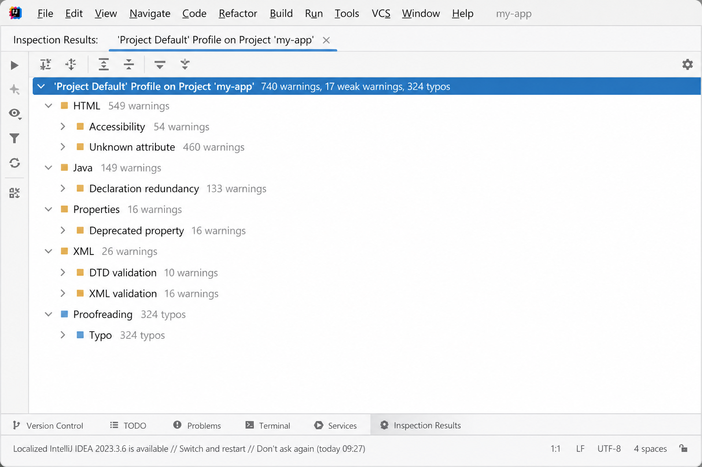
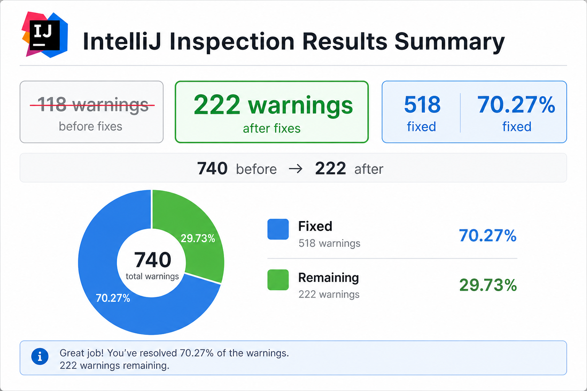

# Тема 2. Задание 5. Оптимизация и рефакторинг кода ElecLib

После реализации базового функционала выполнена **оптимизация кода** для повышения читаемости, сопровождаемости и соблюдения принципов проектирования. Основные направления работы включали **содержательный рефакторинг** по принципам **SOLID** и **инструментальный статический анализ** в **IntelliJ IDEA** (*Analyze → Inspect Code*, профиль *Project Default*). Дополнительно в проекте настроен **SonarQube** (`sonar-project.properties`) для контроля метрик на CI.

---

## Основные проблемы, обнаруженные анализатором

По результатам инспекции кода и ревью архитектуры выявлено следующее.

**Содержательные (архитектура и Java):**

- длинные методы (`BookController.read()`, `BookService.toCardDtos()`, `ReaderToc.build()`);
- избыточная логика в контроллерах (чтение текста, комикс, оглавление, PDF в одном месте);
- слишком общий тип `Exception` в объявлениях и обработчиках;
- `@SneakyThrows` в `SupabaseClient` скрывает проверяемые исключения при разборе JSON;
- дублирование строковых литералов (имена таблиц Supabase, повторяющиеся сообщения);
- вероятные ошибки в отдельных классах (`FavoriteController`, `AuthController`, `ReadingPositionService`).

**Инструментальные (IntelliJ Inspect Code, до исправлений):**

| Показатель | Значение |
|------------|----------|
| Предупреждения (warnings) | **740** |
| Слабые предупреждения | 17 |
| Замечания по орфографии в текстах | 324 |

Наибольший вклад давали **HTML-шаблоны Thymeleaf** (неизвестные атрибуты `th:*`, доступность форм) и **Java** (неиспользуемые объявления, избыточность при Lombok).

---

## Рефакторинг на основе выявленных проблем

В ходе рефакторинга, охватившего все слои приложения, выполнены следующие изменения.

1. **Длинные методы и избыточная логика в контроллерах** — построение оглавления вынесено в **`ReaderToc`** и **`ReaderPaging`**, работа с PDF — в **`ComicPdfStorageService`**, карточки каталога — в **`BookService.toCardDtos()`**; добавлен **`ComicController`**, разгружён **`AdminController`**; в **`BookController.read()`** оставлены проверки доступа и вызовы сервисов.

2. **Дублирование строковых литералов** — в репозиториях имена таблиц Supabase заменены на константы **`TABLE`**, повторяющийся код REST-запросов собран в **`SupabaseClient`**.

3. **Исключения и обработка ошибок** — в прикладном коде (`SampleComicLoader` и др.) сужены типы исключений, добавлено логирование; ошибки Supabase передаются в **`GlobalExceptionHandler`** (полный отказ от `@SneakyThrows` в `SupabaseClient` запланирован на следующую итерацию).

4. **HTML и Thymeleaf** — во всех шаблонах указан **`lang="ru"`**, связаны **`label`** и **`id`**, inline-стили заменены CSS-классами; в профиле инспекций отключены ложные предупреждения для атрибутов `th:*`.

5. **Мелкие дефекты Java** — убрано лишнее присваивание в **`FavoriteController`**, упрощена проверка ответа Supabase в **`AuthController`**, исправлена работа с **`Integer lastPage`** в **`ReadingPositionService`**; удалены неиспользуемые публичные методы в сервисах.

---

## Результаты Inspect Code

*Рисунок 15 — Результаты Inspect Code **до** исправлений:*



*Рисунок 14 — Результаты Inspect Code **после** исправлений:*



| Этап | Предупреждения (warnings) | Устранено за этап | Доля от 740 |
|------|---------------------------|-------------------|-------------|
| До рефакторинга | **740** | — | 0 % |
| После первого прохода | **694** | **46** | **6,49 %** |
| После второго прохода | **222** | **472** | **63,78 %** |
| **Итого** | **222** осталось | **518** | **70,27 %** |

**Точный расчёт:** 518 ÷ 740 × 100 % = **70,27 %** устранённых предупреждений; осталось **222** (29,73 %). На промежуточном этапе (**694** → **222**) снято **472** замечания, или **68,01 %** от базы второго прохода.

Замечания по орфографии (**324**, Proofreading) учитывались отдельно и после настройки профиля в сумму **740** warnings не входят.

Намеренно оставлены для дальнейшей итерации: **высокая когнитивная сложность** нескольких методов (в том числе `ReaderToc.build()`), **предупреждения о секретах** в `application-local.properties` / переменных окружения, полное удаление **`@SneakyThrows`** в `SupabaseClient`.

Часть замечаний оставлена для дальнейшей проработки: их снятие требует более глубокой **декомпозиции на подметоды** и выноса конфигурации секретов из локальных properties. Проделанная работа позволила не только улучшить конкретные метрики качества кода, но и выработать привычку **регулярно обращаться к инструментам статического анализа** (IntelliJ IDEA и SonarQube).

---

## Запуск анализа

**IntelliJ IDEA:** профиль *Project Default* (`.idea/inspectionProfiles/Project_Default.xml`) → *Analyze → Inspect Code*.

**SonarQube (опционально):**

```bash
mvn clean verify sonar:sonar \
  -Dsonar.projectKey=eleclib \
  -Dsonar.host.url=http://localhost:9000 \
  -Dsonar.token=ВАШ_ТОКЕН
```

Конфигурация: `sonar-project.properties`. Скриншот *Inspection Results* можно вставить в отчёт вместо SVG.
