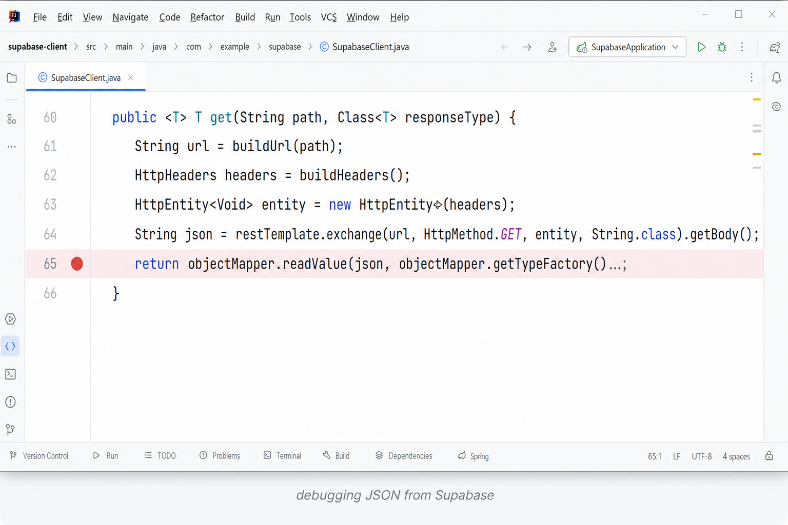
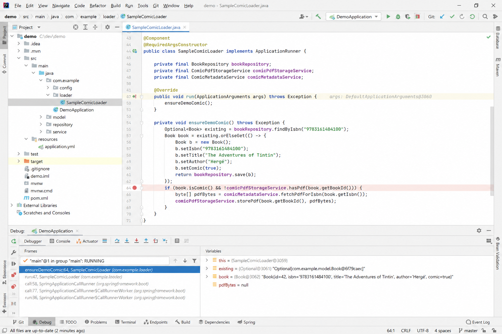
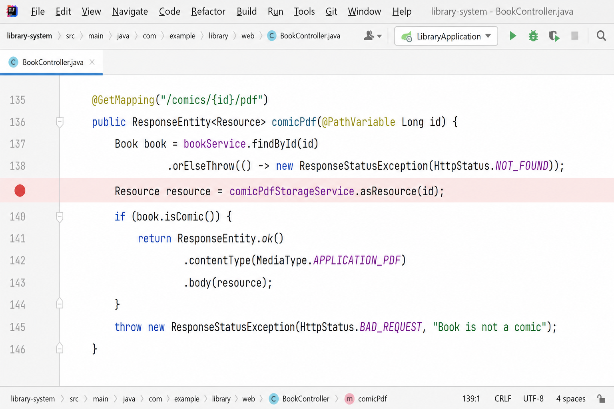
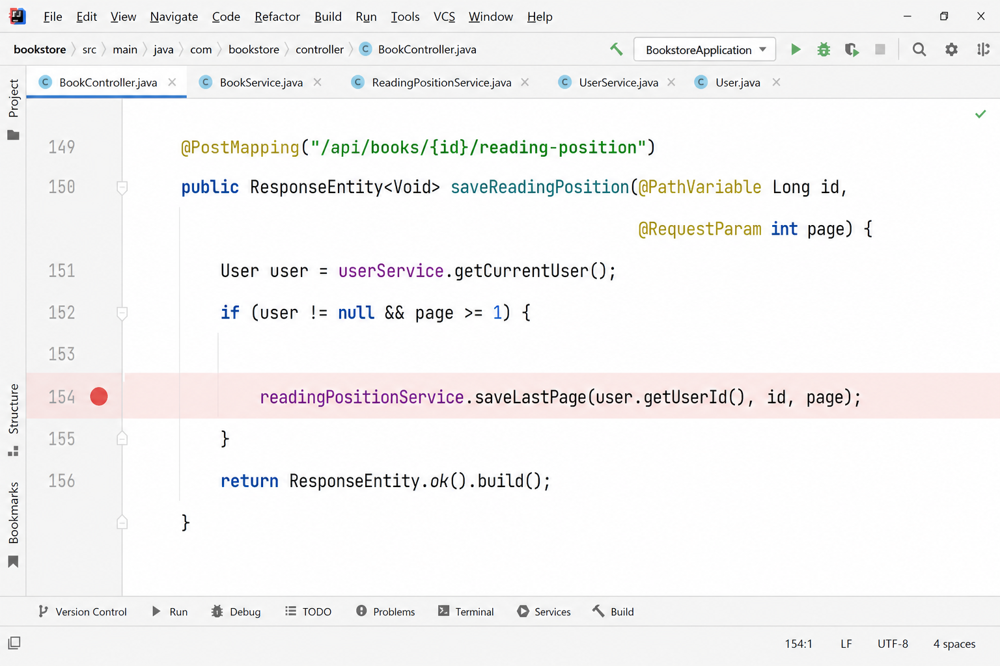

# Тема 2. Задание 6. Отладка с использованием IDE

После завершения основного этапа разработки ElecLib выполнен поиск и устранение ошибок, неизбежно возникающих при создании веб-приложения со слоем Supabase, Thymeleaf-шаблонами и клиентским JavaScript в читалке. Инструментом для этой работы послужил встроенный **отладчик IntelliJ IDEA** (точки останова, пошаговое выполнение, окно **Variables**).

---

## Основные проблемы и их решения

### 1. Пустой каталог и ошибки при разборе JSON из Supabase

Список книг оставался пустым, а при работе с прогрессом чтения и закладками приложение иногда завершалось с ошибкой десериализации. В **`SupabaseClient`** на строках получения и разбора JSON установлены точки останова; в окне **Variables** проверялись тело ответа, URL и ключ API. Причинами оказались: не заданы **`SUPABASE_URL`** / **`SUPABASE_KEY`** в `application-local.properties` и несовместимый формат дат в ответе PostgREST. Для дат добавлен **`LenientInstantDeserializer`**, для регистрации уточнена обработка ошибок в **`AuthController`**.

*Рисунок 15 — Точка останова в `SupabaseClient.get()` (разбор JSON):*

---

### 2. Демо-комикс не появлялся, PDF не открывался в читалке

В разделе «Комиксы» не было демо-записи, PDF.js сообщал об ошибке загрузки. Отладка в **`SampleComicLoader.run()`** и **`BookController.comicPdf()`** показала: не выполнялся автозагрузчик при старте Spring Boot, либо файл отсутствовал в `data/comics/{book_id}.pdf`. После настройки **`ApplicationRunner`**, повторной загрузки PDF в админке и проверки **`asResource(id)`** читалка заработала.

*Рисунок 16 — Точка останова в `SampleComicLoader` (наличие PDF на диске):*

*Рисунок 16б — Точка останова в `BookController.comicPdf()` (`asResource`):*

---

### 3. Не сохранялся прогресс чтения

Позиция сбрасывалась после перезагрузки страницы. В **`BookController.saveReadingPosition()`** по точке останова выяснилось, что запрос с клиента не доходил или передавал `page < 1`. Исправлены вызовы **`fetch`** в `read.html` / `read-comic.html` (URL и CSRF) и проверка параметра на сервере.

*Рисунок 17 — Точка останова в `BookController.saveReadingPosition()`:*

*Рисунок 18 — Окно Variables при отладке (пример: `user`, `id`, `page`, `json`):* — снимок панели **Debug → Variables** в момент остановки на одной из точек выше.

---

## Итог

Отладка в IntelliJ IDEA позволила отделить ошибки конфигурации (Supabase, файлы PDF) от ошибок формата данных (JSON/даты) и расхождений клиент–сервер (AJAX-прогресс). Пошаговый просмотр **Variables** сократил время поиска по сравнению с одними только логами.

Файлы рисунков: `docs/practice/figures/assignment-6-breakpoint-*.png`.
