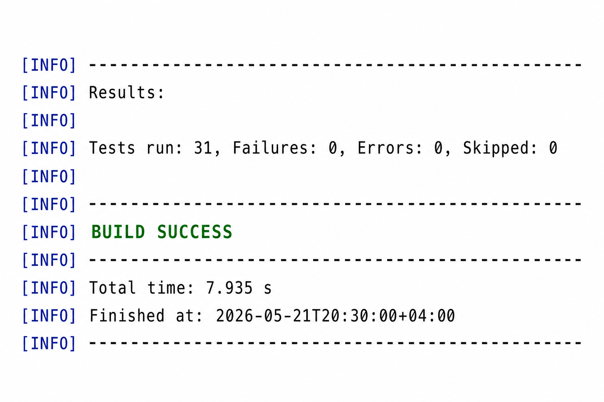
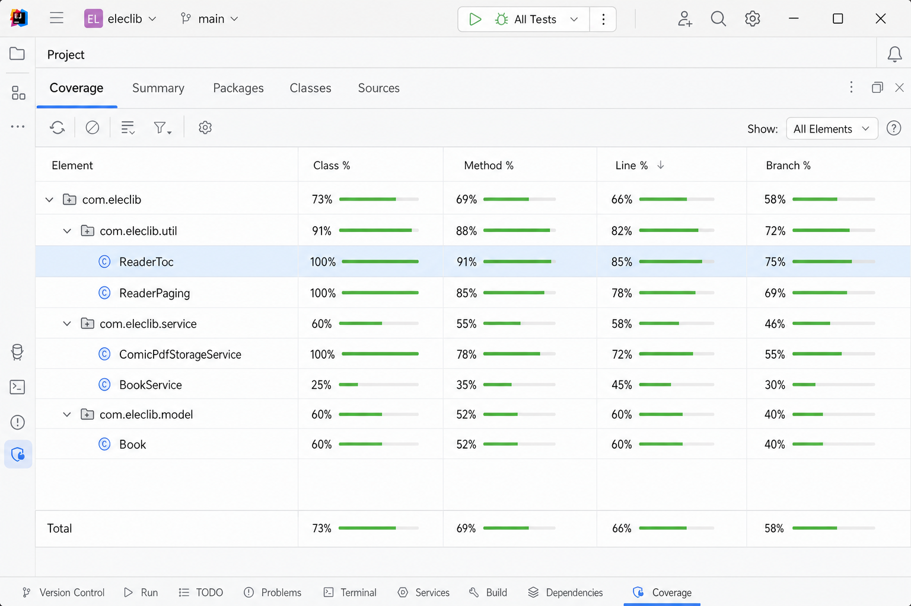

# Тема 2. Задание 7. JUnit-тестирование

Проведено автоматизированное тестирование модуля ElecLib с использованием **JUnit 5** и **Mockito** для проверки логики сервисов и утилит, в том числе **трёх новых функций**: оглавление в читалке, комиксы (PDF) и обложки в каталоге.

---

## Тесты для новых функций

| Функция | Класс тестов | Что проверяется |
|---------|--------------|-----------------|
| **Оглавление** | `ReaderTocTest` | распознавание строк-заголовков (`Глава`, `§`, `###` …), построение списка `ReaderTocEntryDto`, номер страницы по смещению |
| **Оглавление / постраничность** | `ReaderPagingTest` | `totalPages`, разбиение текста (~2500 символов), согласованность с читалкой |
| **Комиксы (PDF)** | `ComicPdfStorageServiceTest` | `hasPdf`, `store`, `asResource`, отклонение не-PDF |
| **Комиксы + каталог** | `BookServiceCardFeaturesTest` | флаги `comic` / `comicReady`, фильтр `findComicsAsCards` |
| **Обложки** | `BookComicAndCoverTest`, `BookServiceCardFeaturesTest` | `coverUrl` в модели и в `BookCardDto` |

Дополнительно (базовая логика приложения): `BookServiceRecommendationTest`, `ReadingPositionServiceTest`, `SubscriptionServiceTest`.

**Всего в проекте: 31 тест** (0 падений, 0 ошибок).

Таблица 3.1 (тестовый план unit-тестов) в HTML: [`assignment-7-unit-tests.html`](assignment-7-unit-tests.html).

---

## Запуск

```bash
mvn test
```

Отчёт покрытия (JaCoCo): после `mvn test` открыть  
`target/site/jacoco/index.html`  
или в IDEA: **Run → Run 'Tests' with Coverage**.

---

## Результаты

*Рисунок 17 — Результат выполнения `mvn test`:*



*Рисунок 18 — Отчёт о покрытии кода (Coverage / JaCoCo):*



Наибольшее покрытие у утилит **`ReaderToc`** и **`ReaderPaging`** (оглавление) и сервиса **`ComicPdfStorageService`** (хранение PDF). **`BookService`** покрыт частично через Mockito-тесты карточек и рекомендаций; контроллеры и Supabase-клиент в unit-тесты не входят (интеграция с БД — отдельная задача).

---

Листинги тестов (11–15): [`code-listings-new-features.md`](code-listings-new-features.md).

## Пример теста (оглавление)

```java
@Test
void build_mapsHeadingsToPages() {
    StringBuilder sb = new StringBuilder();
    sb.append("Глава 1\n").append("x".repeat(3000)).append("\n").append("Глава 2\n");
    List<ReaderTocEntryDto> toc = ReaderToc.build(sb.toString());
    assertEquals(2, toc.size());
    assertEquals(1, toc.get(0).getPageNumber());
}
```

Проделанная работа подтвердила корректность разбиения текста, построения оглавления, признаков комикса/обложки на карточках и сохранения PDF на диск без запуска полного веб-интерфейса.
